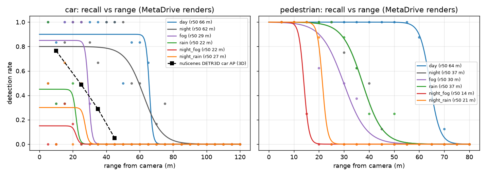
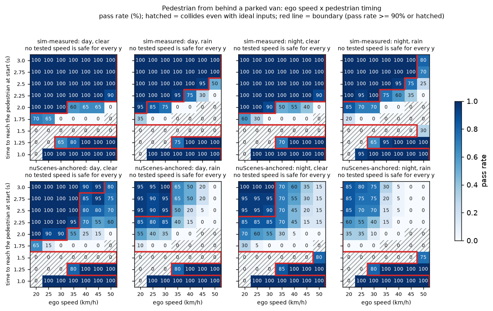

# ADAS Perception + Scenario Validation

Closed-loop validation of a camera-based ACC/AEB system in simulated driving scenarios: a car cutting in, a pedestrian stepping out from behind a parked van, a lead car braking hard. Each runs by day and at night, in clear weather, rain and fog. A real detector, measured on simulator images and cross-checked against published nuScenes results, drives a perception error model. Every verdict comes from simulator ground truth. Each collision is traced to its triggering condition with counterfactual reruns (a SOTIF-style failure table), and parameter sweeps find where the system stops being safe.



## Why it matters

Software-defined vehicle programmes such as Stellantis STLA Brain are limited by validation, not by models. Engineering consultancies staff OEM projects with engineers who can design scenarios, measure safety and explain failures. SOTIF (ISO 21448) asks exactly this: under which conditions does the intended function fail, and why?

**Relevant employers in Italy:** Stellantis, Italdesign, Teoresi, Akkodis, Reply, VisLab (Ambarella), Maserati

## How it works

```
MetaDrive (ego physics, scripted actors, 3-lane road)
   │ ground truth: positions, line-of-sight occlusion
   ▼
perception error model ── detection probability vs range, per class and condition,
   │                       noise, 0.1 s latency, ghost objects
   ▼
tracker (M-of-N confirmation) ──► ACC + AEB (width-aware path prediction,
                                  wet-road braking limit) ──► throttle / brake
verdict from ground truth: collision, impact speed, minimum TTC, first-detection range
```

**Where the perception parameters come from.** No dataset download is needed. Three models are compared:

| Model | Detection curves | Source |
|---|---|---|
| assumed | hand-set, plausible values | `configs/perception_model.yaml` |
| **sim-measured** | **measured**: torchvision Faster R-CNN (COCO) on 272 MetaDrive camera renders × 6 conditions (night lighting, Koschmieder fog and rain applied with per-pixel scene depth) | `make render-calibration fit-calibration` |
| **nuScenes-anchored** | car curve fitted to camera-only DETR3D car AP by distance on nuScenes val ([TransCAR, Table 6](https://arxiv.org/abs/2305.00397)); pedestrian range scaled by the MonoDIS pedestrian/car AP ratio ([nuScenes paper, Table 6](https://arxiv.org/abs/1903.11027)); condition factors from the renders | same |

## Results

540 runs per model (18 scenarios × 30 perception seeds, about 20 s on a Mac). Pass means no collision.

| | assumed | sim-measured | nuScenes-anchored |
|---|---:|---:|---:|
| **Overall** | 70% | 60% | 35% |
| Cut-in (20 m gap, 90 vs 60 km/h) | 100% | 100% | 77% |
| Lead car brakes at 6 m/s² (90 km/h, 30 m gap) | 80% | 36% | 14% |
| Occluded pedestrian (40 km/h) | 29% | 45% | 13% |
| **Occluded pedestrian, rain (day and night)** | **0/60** | **0/60** | **0/60** |
| Lead car brakes, night, clear | 100% | 100% | 33% |

**What the measurements show**
- **Lit cars barely lose range at night; unlit pedestrians do.** Night detection range vs day: car 0.95, pedestrian 0.58. nuScenes agrees for cars: DETR3D car AP is 52.2% at night vs 54.8% by day ([TransCAR, Table 8](https://arxiv.org/abs/2305.00397)). The perception model therefore has per-class condition factors.
- **Fog and night compound.** The range factor measured for both together is 0.28, against 0.35 predicted by multiplying the two separate effects. Night and rain roughly multiply (0.37 vs 0.35).
- **There is a sim-to-real gap.** A 2D detector on clean simulator images keeps cars out to about 66 m; camera-only 3D detection on nuScenes falls to 50% AP at about 28 m. The sim-measured model is optimistic, which is why the anchored model exists. Synthetic rain hits this detector's car class much harder than nuScenes' rain subset hits DETR3D, where much "rain" footage is wet road rather than falling rain.

**What doesn't depend on the perception model.** The occluded pedestrian in rain fails 60 of 60 under all three models. The pedestrian becomes visible at about 12 m, and from 40 km/h on a wet road (6.5 m/s²) the car needs about 9.5 m plus reaction time to stop. The counterfactual reruns below confirm it: with perfect perception the car still hits at 7 km/h, and only dry-road braking removes the collision. Lead-car braking, by contrast, depends entirely on detection range: with realistic camera-only range, a 30 m gap at 90 km/h sits at the edge of what the system can handle.

## SOTIF failure analysis: why does each collision happen?

ISO 21448 (SOTIF) asks under which triggering conditions a function is unsafe without any fault, and whether that is a *performance insufficiency* (it can't do what it should here) or an *insufficiency of specification* (it was never asked to). Every collision is rerun with one limitation removed at a time, and the cause is the first change that prevents it: perfect detection → no position noise → dry-road braking → no latency and instant track confirmation → AEB knows the lead's deceleration. If none helps, it is a design limit. Full tables with triggering conditions, impact speeds and mitigations: [docs/SOTIF.md](docs/SOTIF.md).

| Cause of collision | SOTIF class | assumed | sim-measured | nuScenes-anchored | edge cases (sim-measured) |
|---|---|---:|---:|---:|---:|
| detection range / misses | performance | 41% | 52% | 71% | 15% |
| position noise → wrong lateral-velocity estimate | performance | 23% | 20% | 12% | 16% |
| wet road, speed not adapted | specification | 37% | 28% | 17% | - |
| reaction latency (0.1 s + 3-of-5 confirmation) | performance | - | - | - | 28% |
| AEB assumes a braking lead keeps its speed | specification | - | - | - | 24% |
| design limit (collides even with ideal inputs) | outside capability | - | - | - | 17% |
| collisions | | 164 | 215 | 353 | 106 |

Edge cases are six sweep cells beyond the catalogue's operating points, by day in clear weather.

**What it shows**
- **Pedestrian failures outside rain are a tracking problem, not a range problem.** Under the sim-measured model, 38 of the 39 non-rain pedestrian collisions are removed by taking out position noise and only 1 by perfect detection. Lateral position noise of about 0.13 m, differenced over 0.1 s, gives about ±1.8 m/s of lateral-velocity error against a 1.4 m/s walk, so the path prediction misjudges whether the pedestrian is walking into the lane. Mitigation: estimate lateral velocity over more frames or from radar Doppler.
- **Lead-car braking fails on detection range** in rain and fog under the measured and anchored models (car detection range drops to ~22-30 m), and with the nuScenes-anchored range even by day (15/30).
- **At 130 km/h the AEB logic itself is the weak point.** The lead is tracked the whole time, but the required-deceleration check assumes it keeps its speed, so the AEB fires late against a braking lead (Euro NCAP's car-to-car rear braking test, CCRb). Knowing the lead's deceleration removes 25 of 28 collisions.
- **A pedestrian stepping out 1.75 s ahead at 30 km/h fails 30/30 on reaction latency alone.** With zero latency and confirmation on the first detection, the same perfect-perception AEB avoids it.
- **A cut-in at 20 m with 50 km/h closing speed is mostly a design limit** (5 of its 9 collisions): the AEB brakes only for objects predicted to be in its path, and a gentle lane change enters that path late. Braking at the cutter's first lateral drift would avoid it, so this limit belongs to the function, not to physics.

## Pass/fail boundaries: parameter sweeps

Each cell is 20 runs (pass ≥ 18/20) plus one ideal-input reference run; about 20,500 runs in about 11 minutes ([configs/sweeps.yaml](configs/sweeps.yaml)). Hatched cells collide even for the same AEB with ideal inputs (perfect perception, no latency), so they don't count against the system. The red line is the highest speed at which every lower speed passes.



| Highest speed handled at every tested value | sim-measured | nuScenes-anchored |
|---|---:|---:|
| Lead car brakes at 6 m/s², every gap 10-60 m, day | 90 km/h | 50 km/h |
| Same, night fog | 50 km/h | none |
| Same, rain | none | none |
| Cut-in at 60 km/h, every gap 5-30 m, day | 90 km/h | 90 km/h |
| Same, night fog | 90 km/h | 80 km/h |
| Pedestrian starting 2.0 s ahead, day: clear / rain | 30 / 20 km/h | 30 km/h / none |
| Pedestrian starting 2.5 s ahead, day: clear / rain | 50 / 45 km/h | 35 / 30 km/h |

- **Pedestrian timing matters more than speed.** A pedestrian who starts 1.0 s ahead walks in behind the car, and one who starts 1.5 s ahead is revealed within a metre or two of the bumper: even the ideal-input AEB collides there at every tested speed. The danger is the band in between (1.75-2.25 s), and rain widens the part that even ideal inputs can't handle. No tested speed handles every avoidable timing: even at 20 km/h, a step-out 1.75 s ahead passes only 14 of 20 runs (at 30 km/h the SOTIF analysis attributes that timing to reaction latency).
- **Long gaps are worse than short ones for a braking lead in rain or fog.** At a short gap the lead is already tracked when it brakes; at a long gap it has stopped before the camera sees it, and the scenario becomes "stationary car ahead": above 50 km/h the wet-road stopping distance is longer than the camera's car range in rain (~22 m).
- More figures: [lead-car braking](docs/figures/sweep_lead_brake.png), [cut-in](docs/figures/sweep_cut_in.png).

All findings are from simulation, with stated assumptions: position noise, latency and ghost rate are still assumed, AP is used as a proxy for detection probability, other road users are scripted (they don't react to the ego), and wet-road friction enters only through the braking limit. What went wrong along the way (and was fixed) is in [docs/ROADMAP.md](docs/ROADMAP.md).

## Quickstart

You need [uv](https://docs.astral.sh/uv/). Docker is only needed for the camera calibration.

```bash
make setup-sim            # MetaDrive (Python 3.11)
make test                 # 29 tests, including a MetaDrive smoke run
make scenarios            # assumed model     -> results/catalogue/report.md
make scenarios-measured   # sim-measured model -> results/catalogue_measured/report.md
make sotif sotif-edge     # counterfactual failure attribution -> results/sotif_*/failure_table.md
make sweeps               # pass/fail boundaries (~11 min) -> docs/figures/sweep_*.png
make render-calibration   # Docker: render + detect (~10 min; macOS can't render offscreen)
make fit-calibration      # fit curves -> configs/perception_model_*.yaml + the figure above
```

## Roadmap

See [docs/ROADMAP.md](docs/ROADMAP.md). Optional later steps: run a 3D detector on nuScenes-mini yourself (needs the free registration and a 4 GB download), and run the same catalogue in CARLA on a cloud GPU.

## In italiano

Validazione a ciclo chiuso di un sistema ACC/AEB basato su telecamera in scenari simulati (MetaDrive): veicolo che si inserisce, pedone che esce da dietro un furgone, frenata del veicolo davanti. Ogni scenario è testato di giorno e di notte, con sereno, pioggia e nebbia. Il modello di errore della percezione è misurato con un rilevatore reale (Faster R-CNN) su immagini del simulatore e confrontato con i risultati pubblicati su nuScenes. Ogni collisione viene attribuita alla sua condizione scatenante (triggering condition) con simulazioni controfattuali: percezione perfetta, nessun rumore, frenata su asciutto, nessuna latenza. Ne risulta una tabella dei guasti in stile SOTIF (ISO 21448). Le scansioni parametriche (19.000 simulazioni) trovano i limiti di velocità e distanza oltre i quali il sistema non è più sicuro. Il risultato più solido: il pedone occluso con pioggia fallisce in tutti i casi, con tutti i modelli di percezione; anche con percezione perfetta l'urto avviene a 7 km/h, quindi il limite è l'occlusione più l'aderenza, non il rilevatore. Con tempo sereno, invece, gli incidenti con il pedone dipendono dal rumore sulla posizione (stima della velocità laterale), non dalla portata del rilevatore.

## Licence

Code: MIT, see [LICENSE](LICENSE). Detector weights: torchvision (BSD-3-Clause). MetaDrive: Apache-2.0. Datasets and third-party assets keep their own licences; see [data/README.md](data/README.md).
